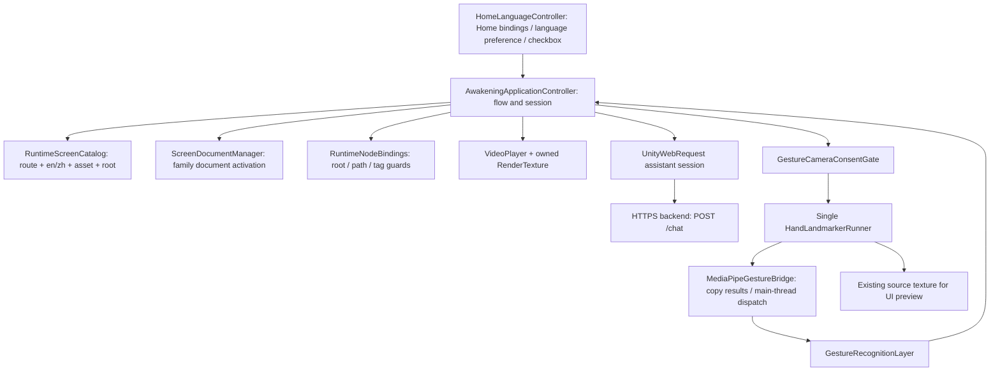

# Current architecture assessment

Stage 1 · 13 November 2026 · baseline `b9f0972b38008b31e4bd2117ee88cb34ef9ce6fe` · static evidence only.

## Configuration and dependencies

| Domain | Inspected current state | Implication |
| --- | --- | --- |
| Editor/platform | `ProjectVersion.txt`: 6000.4.7f1; Player default 1920×1080, fullscreenMode 1, not resizable, Linear color, both input backends | User confirms ROG Strix G16 / RTX4060 8GB / 16GB RAM and current FHD. Exact CPU, DPI, power profile and actual runtime graphics API remain unrecorded. |
| Build | `EditorBuildSettings.asset`: only enabled scene `Assets/Scenes/SampleScene.unity` | Sample scenes are not production entry points. No build/compilation was run. |
| Pipeline | Graphics default null; all six Quality overrides reference GUID `681886…` → `Assets/Settings/UniversalRP.asset`; renderer GUID `424799…` → `Renderer2D.asset`; Standalone default quality 5, saved current 0 | Both serialized choices lead to URP 17.4, 2D renderer. Do not infer runtime quality/API without execution. |
| Renderer | Renderer features empty; opaque/depth texture off; renderScale 1; MSAA 1; HDR supported | No existing custom glass pass to extend; camera opaque texture would not capture overlay UI. |
| UI panel | Shared `Assets/UI Toolkit/PanelSettings.asset`; target texture null, render mode 0, scale mode 0, scale 1, ref 1200×800; textSettings null | Screen overlay, constant pixel size; reference resolution does not make fixed roots responsive. Built-in filter shader slots do not prove backdrop blur. |
| Packages | MediaPipe 0.16.3 local tarball, Input System 1.19.0, URP 17.4.0, Test Framework 1.6.0, Figma 0.2.0-exp.1, transitive App UI 2.1.1 | Installed editor AI/inference packages are not the visitor assistant runtime. No new package is justified yet. |
| Tooling | MCP embedded package 10.3.0 despite manifest Git main; Figma prebuild mapping validator; Editor pipeline asset | Tooling presence is not runtime behavior, approval, or a passing build. |
| Backend | `awakening-ai-backend/server.js`, Express, Helmet, per-IP rate limit, environment credentials; `POST /chat` | Actual deployment/availability/configuration is unverified. No request was made. |

The 16 UIDocuments are Home EN, Home ZH, Privacy, Tutorial, Attract, ColorRelease, Focus, Activation, LivingPortrait, Release, PostVideoAssistant, AssistantChooser, Settings, Closing, Souvenir and AssistantOverlay. Two Home documents are enabled in serialized state at order 0, thirteen main family documents disabled at 10, overlay disabled at 20. All share the panel. The older independent PerformerSelection document/catalog pair is absent; current selection is integrated into Color Release.

## Ownership and lifecycle

| Owner | Actual responsibilities | Cleanup / caution |
| --- | --- | --- |
| `HomeLanguageController` (757 lines) | Separate Home trees, hard-coded validated node mappings, grouped controls; `PlayerPrefs` persists language only; consent is memory-only | Disposes element event registrations on destroy; roots kept alive intentionally. Locale changes call `ApplyLanguage`, then notify app. |
| `AwakeningApplicationController` (2,976 lines) | Session flags, route guards/history, all page binding, shared input, gesture targeting, transition coroutines, audio, video, preview, assistant UI and network | Numerous explicit unbind lists and video release paths are positive. Disable-time direct-page assistant cancellation is incomplete (AC-10). |
| `ScreenDocumentManager` (113 lines) | Family resolution, activation/deactivation, order 10/20, source assignment | Does not own business state, consent or callback cancellation. Fallback generic navigation document path remains in controller. |
| `RuntimeScreenCatalog` (61 lines) | Linear lookup by logical route and `en`/`zh`; 104 records, 52 paired routes | Missing asset fails closed; no dynamic product completeness inference. |
| `MediaPipeGestureBridge` (348 lines) | Subscribes runner results, copies arrays under lock, processes latest result on Unity thread, tracking diagnostics | No camera creation. Resets tracking on consent loss; drops superseded results intentionally. |
| `GestureRecognitionLayer` (1,030 lines) | Identity/filter histories, wave/clap/point/fist/palms, dwell/release/cooldown | Pure semantic layer with Unity math/time diagnostics; thresholds are existing behavior, not motion tokens. |
| `GestureCursorController` (173 lines) | Visual point smoothing, panel picking, optional synthetic click helper | Current app targets Color Release via picking; a click helper alone does not establish global gesture UI support. |
| Modified MediaPipe sample code | Gate + HandLandmarkerRunner + hand config + source/bootstrap lifecycle | These are application integration code inside a sample assembly; never delete as “unused samples.” |

## Current flow and state contracts

Home checkbox → Privacy review → consent-confirmed Tutorial (seven sequential routes plus separate Return/Dismiss variant) → Attract → first wave or pointer/keyboard equivalent → Color Release presentation → six-way selection. The source default presentation interval is 2s; selecting becomes ready afterward. A wave sets `hasAwakenedThisSession` on entering Color Release, while `awakeningSequenceCompletedThisSession` is set after presentation; these are distinct flags. Later Home/Attract/tutorial navigation is normally redirected into Color Release, with explicit Done/Settings Home paths bypassing that redirection. Do not simplify these semantics without approval.

Selection → Focus → Activation → Living Portrait → Release → PostVideo AI → Closing → optional Souvenir. Focus pointer/keyboard or both palms starts the cinematic chain. Activation is automatic (3s including fades); Living Portrait is automatic on actual video completion. Release and PostVideo continue through explicit input. Back has special video cancellation and filters post-awakening history to exclude Activation/Living Portrait. `ReturnHomeFromSettings` clears selected performer; `ReturnHomeFromDone` clears history and stops capture/audio but does not reset all awakening/consent fields. The exact next-visitor/reset contract needs a product decision.

Settings is entered through Home events or chooser linkage. It provides Language, Privacy and assistant chooser, with Home return. Sound, Accessibility, Tracking/recalibration, Restart and Guide remain explicitly disabled. The actual audio/gesture integrations now exist despite older comments saying they do not; disabled Settings integration is still genuinely absent.

## Camera and gesture contract to preserve

`GestureCameraConsentGate` resets session consent and preview false at subsystem initialization, rejects a second registered runner, and forwards capture permission independently of preview visibility. App Awake/disable also deny capture. Runner bootstrap/capture waits for consent, starts only after bootstrap readiness, handles startup exceptions and releases readback pool/task/source on stop. Windows config uses CPU delegate, CPUAsync reads, LIVE_STREAM and two hands.

`Navigate` grants the capture gate only when session consent is true and a gesture-eligible route is active: Attract, Color Release, performer stages, and post-awakening Closing/Souvenir. Home, Settings, Privacy and chooser stop it. Sample preview is forced hidden; the app's UI preview reuses the existing source only on Attract/Color Release/Focus/Release and hides during assistant overlay. Preview visibility never grants permission. A future shell must explicitly preserve or revise route-based capture suspension; it cannot simply leave capture running because Settings becomes an overlay.

Wave awakens; clap plays audio; point only targets; fist confirms Color Release target; both palms starts Focus video flow; one open palm held 2s requests Back. Existing pointer/keyboard alternatives exist but first entry is still gated by the consent checkbox. Full consent-free visitor participation is not currently an implemented path and requires a policy decision.

## Performer and media evidence

| Index / key | Code | Serialized clip GUID resolves to | Locale/stage coverage |
| --- | --- | --- | --- |
| 0 GAIA | PER-001 | `Assets/Resources/Videos/LivingPortrait/Gaia.mp4` | All five stages × EN/ZH |
| 1 PANDEMIC | PER-002 | `…/Pandemic.mp4` | All five × EN/ZH |
| 2 RE-BIRTH | PER-003 | `…/Re-Birth.mp4` | All five × EN/ZH |
| 3 WHITE-GUARDIAN | PER-004 | `…/White_Guardian.mp4` | All five × EN/ZH |
| 4 CONSCIENCE | PER-005 | `…/Conscience.mp4` | All five × EN/ZH |
| 5 SANCTUARY | PER-006 | `…/Sanctuary.mp4` | All five × EN/ZH |

All six importers enable transcoding and serialize codec 2; retain and verify the intended VP8 importer setting/output in Unity before release. An `.mp4` source extension does not establish the codec Unity will play. Source playback reuses one VideoPlayer, allocates an ARGB32 RT from clip dimensions (64–4096, fallback 1920×1080), waits for preparation and fade visibility, reveals the Image on first decoded frame, and advances through `loopPointReached`. It unregisters callbacks, stops the player and releases owned texture on cancellation/navigation. Default missing/error behavior restores artwork and advances after 10s when `automaticallyAdvancePlaceholderPortrait` is enabled; with it disabled or timeout <=0, retain the configured hold behavior. Never replace the real completion event with a general motion timer.

Video audio is explicitly disabled (`VideoAudioOutputMode.None`) despite imported audio. Environmental audio is separate: optional clip/source, mode once/loop/toggle; neither clip nor source is serialized in the scene, so the source fallback is a generated one-second chime. This is existing implemented fallback, not a broken configured music asset.

## Assistant and localization evidence

Chooser offers six themed overlays with text input, suggestions, request status, reply rendering and Retry. PostVideo has three prompt actions and a conversation, without free text. Client validates a root HTTPS URL, sends a performer-scoped message, uses 45s timeout, guards session identity and aborts navigation/overlay-close requests. Backend uses environment credentials, 4,000-character limit, 16KB body limit, 20 requests/minute/IP, 30s upstream timeout and one retry. It passes one string to the model; no conversation history or verified performer corpus is supplied. Persona correctness, content approval, network reliability and privacy notice remain open; do not describe thematic prompts as a complete knowledge system.

Catalog locale parity is complete; runtime strings frequently use conditional English/Traditional Chinese text. Internal identifiers `zh`/`AppLanguage.Chinese` must remain compatible. Local fonts include Source Sans 3, Source Serif 4, Noto Sans SC and Noto Serif SC; most later exports assign Inter even to Chinese text. Explicit Traditional Chinese typography/fallback is not established by those filenames or catalog coverage.

## Historical reconciliation

`RuntimeArchitecture.md`, `ImplementationPlanAndRunbook.md`, `InteractionAudit.md` and `ValidationReport.md` describe missing assistant/audio/gesture services and earlier route mappings. Current code supersedes those statements. Older reports also describe Souvenir Done → Performer Select; current code returns Home. Preserve historical reports as historical evidence and use this dated baseline for planning. Historical runtime checks do not prove this checkout's regressions pass.
