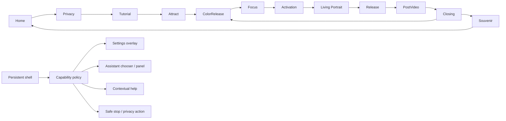

# Global navigation and overlay redesign

Stage 1 proposal · 13 November 2026 · implementation requires review. Finding references: AC-01/03/07/10; features F19–F21/F27–F33/F39.

## Current limitations and intended shell

Today Settings is a routed page entered mainly from Home; AI overlays open from the chooser, with PostVideo AI implemented separately. Returning from Settings invokes a Home path and clears selection. These routes work in source but do not supply session-wide access. A new overlay must not be wired onto the current full-page click capture without changing input arbitration.

Propose a persistent **application shell** in the shared panel, retaining existing page-family documents during migration. It owns shared Settings, AI, Help and return actions, localized status, focus scopes and modal priority. The page area owns the experience. Initial proposed ordering: Home/base 0, page 10 (existing), shell chrome 15, ordinary overlay 20 (reuse current assistant plane), confirmation/privacy-stop 30, noninteractive status 40. Values are a reviewed migration convention, not edits made to serialized assets. Decorative status/cursor layers ignore picking. Focus and command scope, not sort order alone, enforce modality.

At 1080p the shell uses a quiet 56–64px control band with text labels and comfortable targets. In cinematic states it reduces to clear availability/status and a safe Stop/Back action; it must not introduce surprise content over playback. Tooltips supplement visible labels, not replace them. Camera status always distinguishes consent declined, capture suspended, warming, ready, hand lost and fault.

## Route and state architecture

The graph preserves the current primary chain; intended next-visitor reset and Settings Home behavior remain review decisions. Logical route IDs and catalog locale pairs remain stable adapters throughout migration. Deferred delivery/reset/calibration business logic is not activated merely because their layouts are specified.

Capability results are **Available**, **Deferred(reason, boundary)**, **Unavailable(reason, recovery)**. They are derived from current route, performer phase, consent/capture state, modal priority, transition and service readiness. They are not stored as another independent set of mutable booleans. A visible disabled action states why and how to proceed.

## Availability policy (proposed)

| Context | Settings / language | AI / performer theme | Help and return | Privacy / capture |
| --- | --- | --- | --- | --- |
| Home | Available | Available without camera; chooser if no theme | Help available; no Back destination | Notice/review available; capture denied |
| Privacy / consent decision | Local language/reading settings available; no stacking another full Settings panel | Deferred until decision dismissed | Close/back respects explicit consent choice | Decline/revoke takes priority; do not imply opening notice grants permission |
| Tutorial | Available at a stable step | Available, return to same step | Context help; skip/back as approved | Capture remains governed by route policy |
| Attract / Color Release presentation | Available after any atomic presentation commit; visible brief deferral | Defer while first awakening commits; otherwise available | No repeat awakening; selection remains intact | Denial/failure has pointer/keyboard alternative subject to approved entry policy |
| Color Release ready | Available | Available, chooser doesn't confirm performer | Help explains point/fist and 1–6; preserve target safely | Settings suspends capture; closing may resume with prior consent |
| Focus | Available | Available with focused performer as suggested assistant | Back returns selection; both-palms trigger masked while modal | Stop remains reachable |
| Focus→Activation / Activation | Deferred to stable Release; show reason | Deferred to stable Release | Existing cinematic no-skip semantics retained; safe explicit stop only | Privacy stop immediately denies capture and performs coordinated cancellation |
| Portrait preparing / playing / exit fade | Deferred to Release; no language rebuild of video tree | Deferred to Release | Existing explicit Back cancellation preserved; no click-to-skip | Capture shutdown independent of video; clear safe exit alternative |
| Release | Available after fade unlocks | Available, selected performer context | Back follows approved history; continue explicit | Eligible capture/preview may resume only through gate |
| PostVideo | Available | Existing embedded prompts remain; global panel is one assistant session, not a competing transport | Continue independent of request; cancel request on leave | Closing AI doesn't grant capture |
| Closing / Souvenir | Available | Available with suggested last theme; no forced performer change | Clear Done/next-visitor destination under approved reset contract | Existing eligible-route capture policy reviewed; no new automatic permission |
| Settings / AI overlay | One topmost overlay; switching panels closes/cancels prior safely | Existing in-flight request belongs to current assistant view | Escape/close first dismisses overlay and restores opener | Privacy stop can preempt all ordinary overlays |
| Confirmation / error requiring decision | Local actions only; no hidden global shortcut bypass | Unavailable with explanation until dismissed | Explicit Cancel/Confirm or safe recovery | Emergency privacy stop remains available |

“Deferred” does not silently auto-open an old request minutes later. Retain at most one intent tied to the current route generation; replacing it requires immediate visible feedback. At a safe boundary show a small “Settings ready — Open” / “設定已可使用 — 開啟” affordance; opening still needs explicit activation. Cancel the intent on Back, visitor reset, consent revocation or incompatible route. No delayed callback navigates on its own.

## Modal, input and focus contract

1. Shell receives semantic commands before experience page handlers. Priority: privacy stop → top modal close/cancel → focused control/text editing → shell action → current experience. Background page clicks, fists, palms and root Enter/Space cannot trigger experience progression while a modal owns input.
2. Permit one ordinary overlay at a time plus at most one explicit confirmation child. Existing overlay stacks become a single authority; do not add a second router or independent AI stack. Chooser can be a view inside the assistant panel rather than a route detour through Settings.
3. Save the actual opening element's semantic ID and current route generation. Move focus into the overlay's heading/first meaningful action; constrain Tab/Shift+Tab; expose labels and Escape. On close, restore opener if present/enabled, otherwise an intentional fallback for the same page. Current `FocusFirstFocusable` is insufficient for opener restoration.
4. TextField editing consumes typing/Enter according to the input contract; Backspace edits text, not history. Test real Traditional Chinese IME composition; do not submit merely because Return finalizes an IME candidate. Suggested prompts have one keyboard stop, even if surface and label are separate.
5. Pointer, keyboard and gesture actions share command IDs and availability decisions. Existing gesture thresholds/recognizer meanings stay unchanged. Current point/fist confirmation only selects performers; generic shell gesture clicking is **not implemented**. Design enlarged target/help alternatives now, but obtain approval for any new gesture meaning before implementation. Until then provide explicit pointer/keyboard global access and truthful gesture unavailability.
6. Locale changes preserve selected performer, consent decision, awakening progress and media lifecycle. Update shell/overlay text independently of the running page. During protected cinematic phases defer page-text rebind to a safe boundary; do not rebuild the VideoPlayer surface or reset playback. Decide whether existing assistant transcript is retained in its original language; do not silently re-send it.

## Camera and resource policies

Session consent is separate from route eligibility, temporary capture suspension, preview visibility and tracking readiness. Opening Settings currently stops capture by route navigation; the proposed Settings overlay preserves that privacy expectation by suspending capture through the same gate, without clearing the visitor's session decision. Closing resumes only if the underlying route is eligible and consent is still valid. Privacy view similarly suspends; explicit revoke clears permission immediately.

Assistant overlays do not require camera capture. Mask experience commands while visible; preserve underlying route policy unless the approved privacy design chooses temporary suspension. This choice must be validated against current PostVideo/chooser differences before implementation. Never use a second webcam/preview or auto-consent to reduce startup latency.

Safe Stop/Back during video cancels preparation/player callbacks, transitions, request work and owned textures atomically before revealing a stable page. Do not implement a new pause/resume video mode without separate approval. A runtime generation token rejects callbacks from an exited route even if the same performer is entered again. Dismissal and cancellation do not count as successful playback.

## Settings and future scope

Recommended structure: Language; Sound (C); Accessibility (C); Camera & Privacy (current consent + C status/control extension); Experience/End session (C reset decision); contextual Help (C Guide merge). Sound/accessibility/calibration/reset/QR functionality remains deferred. Their designs include disabled reasons and no-device/no-service/error states. No fake toggles or QR success is exposed during the primary overhaul.

## Acceptance and migration

Approve this policy table before building shell structure. Implement shell behind the existing app facade; move Home Settings entry first, then selection/Focus, then stable performer pages, and finally protected-phase status. At every step enforce one active page, one modal authority, one media session and one capture owner. Avoid full-page click capture swallowing new shell controls. Validate every route × locale, opener restoration, rapid open/close, repeated input, camera suspension and late responses. Roll back by restoring prior scene/catalog/presenter commits together; do not leave two command owners active.
