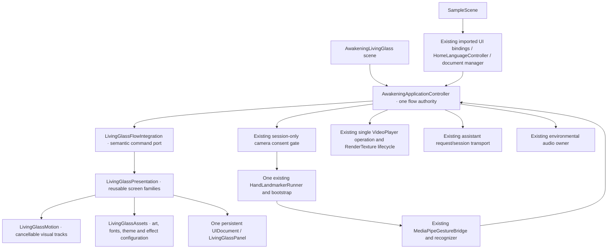

> **Historical snapshot — superseded for the active repository by [Stage 3.4](Cleanup/FinalLegacyRetirement/Architecture.md).** SampleScene operational rollback and imported-demo dependency statements below describe the earlier phase. Recovery now uses the verified archival commit/bundle; Living Glass is the sole development entry. Original findings are retained as historical evidence.

# Stage 3 architecture and compatibility boundary

The Stage 3 brief authorizes the parallel implementation and necessary architecture. The original scene remains the fallback and production build entry. This package does not authorize cutover, cleanup, live camera/AI testing or Player builds.

The new presentation is not routed through imported UXML indices, Figma node IDs, `RuntimeNodeBindings`, legacy Home documents or `ScreenDocumentManager`. The shared controller selects that compatibility path only when its serialized `livingGlass` reference is absent. In the new scene it delegates composition to the dedicated view and uses its semantic command port. No second application controller is added. The old scene retains its serialized fields, GUIDs and imported presentation assets.

The controller remains the temporary owner of proven session, route, video and assistant lifecycles. This is a deliberate compatibility boundary rather than a claim that every Stage 1 target service has already been extracted into an independent class. Its legacy UI routines remain available for the preserved scene. Service extraction can proceed after both scenes have runtime evidence; creating a second competing video or assistant system to avoid this boundary would increase migration risk.

| Responsibility | Authority | Presentation restriction |
| --- | --- | --- |
| Visitor route/history/awakening/performer commit | Shared application controller | No motion callback navigates |
| Session consent | Existing gate + controller session choice | Preview never grants consent; no persistent camera preference |
| Camera capture | Existing runner, registered with the gate | No new capture component |
| Gesture recognition/stability/release/cooldown | Existing recognizer and controller thresholds | No detector retuning; fist scope remains performer selection |
| Screen/locale composition | Living Glass view | Same logical IDs and `en`/`zh` identifiers |
| Modal semantic scope and request invalidation | Integration port | Single ordinary window; window covers/inerts background |
| Modal pose and theme/portrait motion | Shared presentation coordinator | Cancel/retarget current visual state; no business completion |
| Video completion | Existing player events | Only configured missing-video fallback may use its existing timer |
| Assistant reply | Existing request/session generation checks | Closing/replacing/minimizing cancels; no detached reply updates |
| Reduced motion/effects | Exhibition asset configuration | Visitor preference persistence remains unavailable |

Settings and Privacy suspend capture as in the existing route behavior. Closing restores capture only for an eligible route with retained session permission. Protected Activation defers ordinary windows; Living Portrait keeps its existing Back cancellation. A separate Stop camera action revokes immediately without opening a cinematic modal. Full Restart/End Experience remains deliberately deferred. Done retains the baseline session semantics; it is not represented as a full reset.

Minimizing AI cancels the request and closes that view. Resume explicitly says it starts a new conversation. This avoids inventing transcript persistence or memory. Global Help explains supported semantic gestures; it does not turn them into arbitrary button clicks.

The scene builder copies the baseline scene once to preserve its serialized rig/media configuration, removes legacy view objects only from that new copy, and wires the isolated presentation. The builder refuses to overwrite an existing parallel scene or save a dirty user scene. It does not change build settings. The resulting scene is independent and does not load SampleScene additively.
