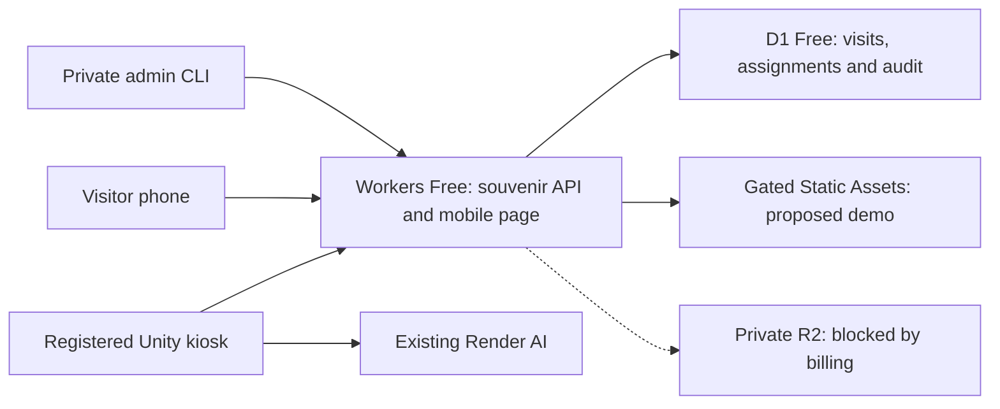
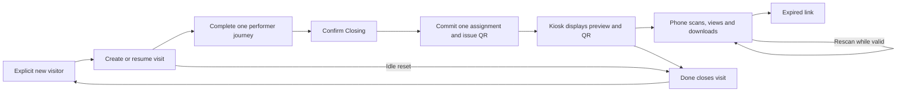

# Stage 5.3A-R — Zero-cost souvenirs and live demo readiness

**Decision.** Use an independent Cloudflare Workers Free service with D1 Free for assignment state. For a controlled $0 demo, propose a small approved image catalog served through the Worker's Static Assets binding with authorization on every request. Keep original files in private operator storage for that variant. The preferred full catalog uses private R2 Standard and Worker-controlled streaming, but **R2 is a deployment blocker under the current rules**. Cloudflare requires an R2 subscription through checkout and charges above included usage. Its Workers spending limit explicitly excludes R2 and is approximate. Application quotas and alerts reduce exposure without guaranteeing a $0 R2 bill. No verified provider-level R2 hard stop meets the requirement. [R2 checkout](https://developers.cloudflare.com/r2/get-started/) · [R2 pricing](https://developers.cloudflare.com/r2/pricing/) · [Workers spending limits](https://developers.cloudflare.com/workers/platform/spend-management/)

The current Unity Closing screen already links to Souvenir. The repository's Node/Express service mounts contextual chat and has no souvenir persistence integration. Keep Render and `/chat/v2` independent. The kiosk calls the souvenir service directly with bounded asynchronous requests. Souvenir failures cannot consume Render's service or OpenAI quota. Rehearse local kiosk and network contention before a public event.



## Provider limits and billing

Official documentation checked **2026-11-15**. Verify the account plan, limits and checkout terms again before a separately authorized deployment.

| Option | Free limits and decision |
| --- | --- |
| **Workers Free** | 100,000 dynamic requests/account/day, reset at 00:00 UTC. 10 ms CPU, 128 MB RAM and 50 external subrequests/invocation, with a separate 1,000 internal-service ceiling and at most six outbound connections waiting for headers. Streaming is supported while connected and does not remove the CPU or request limits. Free exhaustion rejects dynamic traffic. Use fail-closed routing. [Limits](https://developers.cloudflare.com/workers/platform/limits/) |
| **D1 Free** | 5M rows read/day, 100K rows written/day, 500 MB/database and 5 GB/account across up to 10 databases. Up to 50 queries per invocation and seven days of Time Travel. Rows scanned and index writes count. Daily exhaustion rejects queries until UTC reset. Storage exhaustion blocks growth. A database processes queries serially, queues bursts and returns overload when its queue fills. Ordered batches are transactions with rollback on error. [Pricing](https://developers.cloudflare.com/d1/platform/pricing/) · [Limits](https://developers.cloudflare.com/d1/platform/limits/) · [Batch API](https://developers.cloudflare.com/d1/worker-api/d1-database/#batch) |
| **R2 Standard** | Monthly allowances are 10 GB-month, 1M Class A and 10M Class B operations, with free Internet egress. PUT/list generally count as A and GET/HEAD as B. Beyond the allowances, Standard rates are $0.015/GB-month, $4.50/M A and $0.36/M B, with billing-unit rounding. The checkout creates a subscription, and Cloudflare says a valid payment method is required when enabling subscriptions. An alert does not stop charges. [Pricing](https://developers.cloudflare.com/r2/pricing/) · [Billing policy](https://developers.cloudflare.com/billing/understand/billing-policy/) |
| **Existing Render Free + Neon Free + R2** | Neon Free requires no card and lists 100 CU-hours, 1 GB database storage and 5 GB transfer/project/month. Compute or transfer exhaustion suspends compute, while storage exhaustion blocks growth. Render Free can spin down, suspend on shared limits and bill bandwidth overage when a payment method is present. External DB/object calls add latency and can contribute to suspension. Sharing the AI service violates the isolation goal, and the R2 blocker remains. [Neon pricing](https://neon.com/pricing) · [Render Free limits](https://render.com/docs/free) |
| **Supabase Free + R2** | Separate Edge Functions and Postgres isolate workloads from Render. Free lists 500 MB/database per project, 500K Edge Function invocations and 5 GB uncached egress. The Free plan can pause after a week of inactivity. Supabase documents service restrictions for sustained Free overuse and no charges while on Free. Proxying images would exceed 5 GB even at the smallest modeled volume. Direct private signed URLs shift those bytes off Supabase but weaken immediate revocation and retain the R2 blocker. Keep a separate Free organization and avoid upgrades/add-ons if reevaluated. [Pricing](https://supabase.com/pricing) · [Free overage policy](https://supabase.com/docs/guides/platform/cost-control) · [Function limits](https://supabase.com/docs/guides/functions/limits) |

Use the free `workers.dev` hostname and an isolated account or verified unused account quota for the demo. Keep Workers and D1 on Free and omit R2 and all billable bindings, add-ons, subscriptions and paid deployment automation. Use role-limited deploy credentials, review the plan and reject paid configuration in deployment checks. Provider hard caps may interrupt availability even if stored assignments survive. [Static Assets pricing](https://developers.cloudflare.com/workers/static-assets/billing-and-limitations/)

## Completion, kiosk and privacy



GAIA, PANDEMIC, RE-BIRTH, SANCTUARY, WHITE-GUARDIAN and CONSCIENCE all qualify under the same sequence policy. Record entry, required performer milestones and arrival at Closing. Extra journeys stay within the visit. Map gesture-dependent milestones to equivalent keyboard and pointer actions. Camera, microphone, AI and optional reflection are never eligibility requirements. Confirm the exact milestone and configured missing-video mappings against each route before implementation.

Enroll each kiosk with a distinct Windows-protected signing key, preferably non-exportable. Use a short-lived one-use challenge and issue a short-lived kiosk credential plus a separate server-issued visit bearer. Bind visits to the device. Persist the creation idempotency key and visit credentials in protected kiosk storage before proceeding. Enforce one open visit per kiosk, ordered milestone IDs, bounded issuance and an idle timeout. A proposed starting timeout is 20 minutes of inactivity with progress or operator recovery for interrupted visits. Done clears the current UI state and leaves issued claims intact. A new key is accepted only on an explicit new-visitor transition. A compromised kiosk can emulate milestones, and anonymous operation cannot tie separate visits to the same person.

Collect no visitor accounts, contacts, images, biometric data or transcripts. Use short-lived, salted abuse counters and log neither tokens nor signed URLs. Proposed retention is 90 days after the exhibition for pseudonymous assignment and admin audit records, then retain aggregate counts. Purge abandoned visits and detailed progress earlier. Keep an assignment through QR expiry and apply retention separately. Export and restore-test metadata under approved retention rules.

## D1 schema and atomic draw

| Table | Fields and constraints |
| --- | --- |
| `kiosks` and `challenges` | Registered key, status and issuance policy. Challenge hash, device, expiry and one-use state. |
| `visits` and `visit_events` | Kiosk FK, unique kiosk/idempotency pair, hashed credential/derivation metadata, policy version, selected journey, state and UTC times. Partial unique index for one open visit/kiosk. Unique event and sequence per visit. |
| `catalog_state` and `images` | Monotonic catalog revision. Immutable version and private object or asset keys, content hash, size, MIME, dimensions, rights and bilingual labels. Approved/active flags and retirement state. |
| `assignments` | Unique visit FK, immutable image-version FK, issuance nonce/key ID, unique indexed QR hash, UTC issue/expiry, revocation. Check positive TTL ≤60 min. Index image FK for counts. |
| `quotas` and `admin_audit` | Bounded counters by UTC window and scope, issuance pause state, and actor/time/action/target/reason. |

1. Read the current catalog revision and ordered active approved IDs in a consistent primary snapshot. Keep at most 100 active versions. Draw an index with Web Crypto random bytes and rejection sampling, which avoids modulo bias. Generate the QR nonce and hash before writing.
2. In one transactional D1 batch, conditionally insert the chosen version only if the visit is still eligible, the catalog revision matches, the kiosk is authorized, issuance is open and quota is available. Catalog mutations increment the revision in the same batch as the mutation. Enforce `UNIQUE(visit_id)` with conflict handling. Increment issuance counters only on insert, using a trigger within the transaction. End the batch by reading the winning row.
3. Concurrent requests return the winner. If no row exists because the catalog changed, reread and redraw with bounded retries. A losing or interrupted request reads the winning row on retry, preserving the image and issuance time. Empty or paused pools preserve completed visits as pending. Bounded reconciliation after recovery runs the same transaction. Retirement applies to future draws. Already issued image versions stay accessible until QR expiry or explicit revocation.

## Fixed QR and private image delivery

Default QR validity is **30 minutes**, configurable up to an absolute **60 minutes**. Use UTC server time recorded at successful issuance. Store a hash of a 256-bit bearer derived from a fresh CSPRNG nonce and a purpose-bound server HMAC. Retain nonce and key ID so authorized kiosk retries can reconstruct the original token. Validate revocation and expiry against primary D1. Rescans return the same image during validity. Expiration returns **HTTP 410**, stops new access and prevents regeneration or extension. The assignment remains stored. Anyone holding the live QR can use it.

The QR contains a fragment. The mobile page removes it from the address bar and submits the token in a same-origin JSON body. The Worker authorizes preview/download with a purpose-bound signed capability for the assignment, image variant and requested disposition. It is valid for **five minutes or the remaining QR lifetime, whichever is shorter**. The media endpoint validates signature, scope, expiry and the current assignment's QR and revocation status on every request. It derives the object key server-side and serves only that authorized variant. Rechecking revocation blocks future requests with earlier grants. It cannot recover bytes already sent or saved.

In the R2 design, reserve an operation before a single private binding GET, then return the object's readable body directly. Do not buffer or transform media in the Worker. Cap stored derivatives at the approved dimensions and byte limits. Return controlled MIME and Content-Disposition, use no-store and no-referrer, and disallow ranges initially to prevent request amplification. The browser gets a Worker URL and no bucket path or credential. For budget safety, use a D1 quota reservation only for admitted R2 GETs. Scope IP and grant throttles before that write. Release no reservation on uncertain failures since the provider might already have counted the request. D1 outage blocks the GET. [R2 streaming API](https://developers.cloudflare.com/r2/api/workers/workers-api-reference/)

For the $0 demo, use the same authorization with `ASSETS.fetch()` on a small immutable catalog. Enforce `run_worker_first = true`, serve media only through the authenticated handler, and deny raw asset routes, alternate hosts and previews. Validate both authenticated and denied routes plus quota failure before release. Keep demo masters outside the deployment. Console or CLI can change approval without Unity edits. New files require an authorized Worker assets deployment, and active QR versions must survive that deployment. Static delivery avoids R2 metering. If streaming traffic is excessive, reduce image size and admission, with a fixture-only presentation when limits cannot be met. [Worker-first asset routing](https://developers.cloudflare.com/workers/static-assets/binding/#run_worker_first)

## API and per-call cost

Prefix `/souvenir/v1` except the mobile page. Verify a device bearer on kiosk routes and its bound visit bearer after creation. Use independent signed admin credentials. Table rates are initial application limits. Requests that reach the script count as one Worker invocation even when denied. Use 2 KiB JSON bounds on public and kiosk calls, parameterized statements and safe localized error codes.

| Endpoint | Auth, payload and response | Quota and store work |
| --- | --- | --- |
| `POST /kiosk/challenge` and `POST /kiosk/token` | Device ID then signed challenge. Returns expiry or device bearer. Invalid/replayed proof 401. | 6/min/device, challenge insert, lookup and consume. |
| `POST /visits` | Device + idempotency header. Returns visit ID, bearer and next milestone. Open different visit 409. | 6/min/device, 60 starts/day/device, lookup and conditional insert. |
| `POST /visits/{id}/progress` | Device + visit, `{eventId, sequence, milestone}`. Returns milestone state. Illegal transition 409. | 12/min/visit, bounded event insert and progress update, duplicate replay reads. |
| `POST /visits/{id}/complete` and `POST /visits/{id}/close` | Device + visit, empty body. Complete returns timestamp after validating required progress. Close returns 204. | 6/min/visit, eligibility read and idempotent state update. |
| `POST /visits/{id}/assignment` | Device + visit, empty body. Returns `{assignmentId, qrUrl, expiresAt, previewGrant}`. 201 for first commit, 200 for valid retry, 409 if incomplete, 410 after expiry/revocation. | 6/min/visit plus global issuance cap. Primary lookup, catalog snapshot and conditional assignment/quota insert. |
| `GET /souvenir/claim` | Public bilingual page shell. | Soft ingress limit, zero DB work. Serve the shell from the Worker with no asset fallback. |
| `POST /claims/resolve` and `POST /claims/download` | `{qrToken}`. Returns bilingual labels and preview grant, or a download grant and expiry. Unknown 404, expired/revoked 410. | 12/min/token plus venue-aware abuse throttle. Indexed hash lookup, no persistent per-scan write. |
| `GET /media` | Five-minute preview or download capability, preferably in an authorization header via same-origin fetch. 200 stream, 401 invalid, 410 expired/revoked. | 6/min/assignment soft limit and hard combined/day ceiling. Primary state check, admission reservation and one selected media read. |
| `GET /admin/images`, `POST /admin/images`, `PATCH /admin/images/{id}` | Admin, bounded list with counts, verified metadata, or `{action, reason}`. 400 invalid file metadata, 409 conflict. | 10/min/admin, indexed/paginated reads and audited catalog changes. |
| `POST /admin/assignments/{id}/revoke` and `POST /admin/issuance` | Admin, `{reason}` or `{paused, reason}`. 204 on success. | 10/min/admin, transactional update and audit. |

Use 403 for foreign kiosk/visit access, 413 for oversized input and 429/503 for limits and dependency errors. Prefer header-based fetch followed by browser save using a temporary object URL. If phone compatibility requires an opaque capability in a Worker URL, redact it across logs and use no-referrer.

## Capacity, ceilings and live readiness

**Planning model:** 30 days, 100 approved versions initially, each with a 4 MB private original, 0.2 MB preview and 1.5 MB download. R2 variant starts at 0.57 GB and gains 0.057 GB per ten added versions. Demo assets include only the 0.17 GB of derivatives. Per visit assume 1 kiosk preview, 1.5 phone resolutions/previews and one full download. Budget 15 Worker invocations, 180 D1 rows read (including the catalog snapshot), and 40 rows written (including indexes and media reservations). These are planning allowances, to be replaced with observed D1 accounting and CPU. Retry, unrelated account usage, interrupted visits, admin uploads and tests need reserve.

| Eligible visits/day | Worker/day | D1 reads/day | D1 writes/day | R2 GETs/day / month | 30-day image bytes | DB growth/month at 7 KiB/visit |
| ---: | ---: | ---: | ---: | ---: | ---: | ---: |
| 100 | 1,500 | 18,000 | 4,000 | 350 / 10,500 | 6 GB | 22 MB |
| 500 | 7,500 | 90,000 | 20,000 | 1,750 / 52,500 | 30 GB | 108 MB |
| 1,000 | 15,000 | 180,000 | 40,000 | 3,500 / 105,000 | 60 GB | 215 MB |

The R2 operation model adds approximately 300 initial Class A PUTs and 30/month for ten versions, before validation, retries and admin lists. Each streamed image adds one Worker call and one media read. I/O wait is separate from CPU. Target <7 ms p95 CPU, no transforms and bounded D1 batches. Static demo media still passes through Workers and consumes dynamic invocations. R2 egress prices do not imply unlimited Worker capacity.

Start a controlled event at **100 assignments/day**, with up to 60 starts per device per day. Raise the event cap to **500/day** only after rehearsal and enough enrolled kiosks. Set **2,000 combined preview/download starts/day**, and **300 D1 MB** before pausing. Pause new assignments when observed/estimated account consumption reaches 40K Worker calls/day, 2M D1 reads/day, or 35K D1 writes/day. Reserve the gap to the provider caps for issued claims, failures and operator access. If reserve shrinks, stop image admissions too while preserving assignments. Approximate edge limits reject obvious abuse before D1. Use atomic admission counters for the hard issuance/media totals. Counter writes count against D1. Provider metrics can lag, and traffic reaching Workers can still exhaust the provider quota. For a hypothetical billing-approved R2 build, additionally reserve each operation before access, cap Class A at 100K/month, Class B at 250K/month and stored bytes at 3 GB, count admin traffic, and stop on uncertain headroom. These caps are operational mitigations only. [Workers rate limiter locality](https://developers.cloudflare.com/workers/runtime-apis/bindings/rate-limit/)

| Setting | Readiness and rehearsal |
| --- | --- |
| Presentation | Architecture diagrams and recorded or local fixtures are suitable now. Clearly label fixtures. |
| Controlled live demo | Conditional on approval of the Static Assets variant, Free-only account verification and rehearsal. Test one and then 10 simultaneous phone arrivals with preview and download, using venue Wi-Fi and cellular. Have an offline fixture ready. |
| Small continuous exhibition | Unverified. Rehearse 30 concurrent phones and 5 kiosk completions as a burst, including ten simultaneous retries for the same visit. For context, 30 phones each fetching 1.7 MB in five seconds imply about 82 Mbit/s and about 24 dynamic calls/s if scan, preview, authorization and download all invoke Workers. Check D1 queueing, p95 CPU <7 ms, provisional p95 claim API <1 s and media first byte <2 s, zero duplicate assignments or authorization bypass, successful expiry and quota shutoff, and usable degraded behavior on the actual venue network. The 1,000/day model is outside the initial operating envelope. |

Use provider dashboard metrics and a free kiosk/operator status indicator that alerts on threshold or dependency failure and on missing status heartbeats. Prefer local warning and manual response. If the service itself reaches a provider hard cap, Unity and the public shell display a bilingual temporary-unavailable state whenever they can load.

## Administration and failure handling

Use a private CLI with individually enrolled, protected admin signing keys, platform account MFA and server-side roles for review, publication, count inspection, pause and revocation. Use short-lived administrator credentials and audit all mutations. Accept JPEG, PNG or WebP with matching MIME and magic bytes, complete bounded decode, max 10 MiB input and 16 megapixels. Reject malformed/animated files, strip metadata and re-encode locally. Limit derivatives to 300 KiB preview and 2 MiB download. Deduplicate normalized bytes by SHA-256 and verify uploaded size and checksum before approval. R2 originals, if ever allowed, go to a separate private originals bucket without a visitor delivery binding. Demo masters stay in private operator storage. Only separately supplied, explicitly approved art enters the pool. Keep immutable versions and retain retired derivatives for outstanding grants.

| Failure | Behavior |
| --- | --- |
| Worker unavailable, D1 outage or provider quota exhausted | Fail closed. Kiosk shows temporary unavailability without blocking Closing or AI. Abort bounded requests and preserve existing records. Resume using the same visit. Reconcile pending completions after recovery. |
| R2/asset unavailable or download interrupted | Show retryable error. Validate every retry against the same assignment and fixed expiry. Data stays on its original version. |
| Expired/revoked QR, invalid or incomplete visit | Claims fail with 410 for recognized expired/revoked tokens. Invalid credentials fail with 401/404 as appropriate. Incomplete visit receives 409 without assignment. |
| Duplicate, concurrent or interrupted assignment | Read and return the durable winning assignment. Never issue another one after network retry, closure or expiry. |
| Oversized file or rejected input | Reject before publication or transfer. Mark invalid import and keep the last valid version available. |
| Kiosk network disconnect | Preserve the current visit and queued milestone IDs locally in protected storage. Retry in order and let the server validate them. No offline draw or callback to the AI backend. |

## Approval and implementation phases

1. Approve the gated Static Assets demo variant, the exact six-route milestone and accessibility map, operator/key custody, catalog limits, venue targets and retention. Keep the R2 version blocked unless a provider-enforced no-charge arrangement satisfies both the no-subscription and zero-billing rules. Verify the Free account configuration before approving a live demo.
2. Under separate implementation authorization, prototype D1 transaction and quota behavior and test token, cache and route bypass, expiry and revocation boundaries. Prepare a fixture presentation before any allowed live rehearsal.
3. Under separate deployment authorization, verify free-only configuration, rehearse the controlled venue scenario, and assess public exhibition readiness against observed concurrency and recovery results.

## Alternative B — Existing Render + Local Images + Managed PostgreSQL

**Proposal awaiting approval.** Six optimized assets fit comfortably in an application deployment, and Neon Free is the stronger database candidate for a bounded demo. The current **public GitHub repository exposes any readable committed files**, and the AI's Render service shares its bandwidth, process and release lifecycle with the proposed module. Those are separate deployment gates. Alternative A remains under consideration. Official sources for this evaluation were checked **2026-11-15**. [Repository visibility](https://github.com/Kiraakatsuki/Awakening_Celebrations_Ver.Ka)

### Deployment shape and asset handling

Read-only Render metadata confirms a Singapore **Free** Node service, no attached disk, root `awakening-ai-backend/` and automatic deployment of commits to `development/stage-5.2-jfc-ai`. The source mounts contextual chat in Express and has no shared static file mount or souvenir database integration. Mount an independent `/souvenir/v1` module with its own DB pool, auth, quotas and failure handling. Keep health and `/chat/v2` independent of souvenir initialization and dependency outages. Module separation cannot isolate shared CPU, memory, sockets, bandwidth or deploys.

```text
awakening-ai-backend/
├── server.js
└── souvenirs/
    ├── catalog.json
    └── images/
        └── six approved, versioned WebP files and optional previews
```

The manifest maps opaque image IDs to immutable filenames, MIME, byte size and SHA-256. Keep the six distribution images outside all public static mounts. Plan for **0.5 MB per download and 0.1 MB per optional preview**, totaling 3.6 MB for all six. Proposed ceilings are 1 MB per download, 150 KB per preview and 6.9 MB per deployed six-image set. Inspect real art for visual quality, dimensions and compression after approval. Stream optimized derivatives and retain private masters offline. Adding/replacing files requires reviewed Git updates and deployment; admin status changes can use Postgres without rebuilding. Deploy a new file before activating it, and retain retired versions in active and rollback builds until outstanding QRs expire. Validate files against the manifest and halt issuance if required assets are missing. Committed assets return with the deployment artifact after sleep or restart. Runtime filesystem writes are ephemeral. [Render Free filesystem behavior](https://render.com/docs/free#local-files-lost-on-redeploy)

**Public Git blocks protected delivery of readable files.** Route authorization protects the Render copy, while anyone can fetch a readable blob from the current GitHub repository or its history. Before a live demo with actual images, approve either a private deployment source or a separately reviewed authenticated encrypted bundle with its decryption key kept server-side. The encrypted variant is outside this base proposal and would need a memory and throughput check. Without an approved private asset path, use a fixture-only presentation. [Public repository](https://github.com/Kiraakatsuki/Awakening_Celebrations_Ver.Ka)

### Visit eligibility, PostgreSQL and assignment

The kiosk and visit credential model in Alternative A applies to B. Register a protected per-device key and use a one-use signed challenge and short-lived server credentials. Keep a durable creation idempotency key and permit one open visit per kiosk. Backend validates ordered milestone events, a single completed journey from any of the six performers and arrival at Closing. Additional journeys belong to that visit. Allow keyboard and pointer equivalents and preserve the approved missing-video path. Camera, microphone, AI and optional reflection are independent. Done or idle reset frees the kiosk, and explicit new-visitor action opens another visit. A compromised kiosk can simulate valid events. Anonymous users can earn another assignment after a new eligible visit.

| Table | Fields and constraints |
| --- | --- |
| `souvenir_catalog` | Stable image-version ID, filename, bilingual display name, optional supplied category/segment, checksum, approval/active status, created and retired timestamps. Unique filename and immutable bytes/version. |
| `visits` | Visit ID, kiosk FK, unique kiosk/creation key, hashed bearer, progress, completed performer ID, start/completion/closure times and status. Partial unique index for one open visit per kiosk. Child milestone events use unique visit/sequence and visit/event ID. |
| `assignments` | ID, unique visit FK, immutable souvenir-version FK, assigned UTC time and status. Index date and image FK. Retain completed performer on the visit and index it for reports. |
| `qr_tokens` | ID, unique assignment FK and unique indexed token hash, nonce/key ID, issued/expiry UTC timestamps and nullable revoked time. Database check enforces a positive lifetime of at most 60 minutes. |
| `kiosks`, `audit_events` | Device registration and policy, admin catalog/issuance/revocation audit, and bounded operational failures with reason codes. Use one aggregate failure counter per UTC day/reason or bounded diagnostic sampling for abuse, rather than a record for every invalid request. |

Use indexed queries or SQL views for total, per-image, UTC daily and per-performer assignments, plus active/expired nonrevoked QRs, revoked assignments and instrumented issuance failures. Record failures after a rolled-back attempt in bounded telemetry if the DB is reachable. During an outage failure telemetry is best-effort. No image bytes in PostgreSQL.

Within one transaction, lock the visit row, return any existing assignment, otherwise require a completed eligible visit. Under a shared catalog lock, read the ordered active approved version IDs and draw with `crypto.randomInt(eligibleCount)` for uniform probability. Admin catalog edits take the exclusive lock in their transaction. Insert the assignment and its QR row atomically and advance quota counters only for successful admission. `UNIQUE(visit_id)` and `UNIQUE(assignment_id)` provide the final duplicate controls. A competing or interrupted request reads the committed winner. Restore or reconcile pending completions through the same locked path. Empty catalog or an outage may defer issuance. Never redraw an assigned visit, including when its image is retired, revoked or its QR has expired.

### Fixed QR and authorized delivery

Keep one unique unpredictable QR bearer per assignment, using a fresh 32-byte nonce, HMAC and indexed hash as described in A. Store the nonce and key ID for authorized retry recovery and keep derivation keys server-side. Use DB UTC issuance time and a **fixed 30-minute default, 60-minute maximum**. Resolve the same image on valid rescans. Expired and revoked tokens return **410**, with no extension or reissue. The assignment remains recorded. Revocation blocks future resolution and media requests. Copies already downloaded or bytes in flight cannot be recalled.

The phone claim page submits its QR bearer in JSON and receives a separate signed media capability for the exact assignment and variant. Limit it to five minutes or the remaining QR lifetime, whichever is shorter. Verify the capability and current QR expiry/revocation on every media request. Obtain the version ID from the assignment and resolve the file only through the checked manifest. Never accept URL-supplied paths or filenames. Verify canonical regular files are beneath the media directory, reject symlinks and arbitrary ranges, and expose no directory listing or public static route. Stream with backpressure, abort on disconnect, set explicit WebP type, safe download disposition, `nosniff`, `no-store` and no-referrer. Never log tokens. A lost upload, file failure or download retry preserves the original assignment.

### Free-tier comparison and Render availability

| Database | Verified allowances and suitability |
| --- | --- |
| **Neon Free** | 1 GB/project, 100 CU-hours/month and 5 GB public egress/month per project. Compute scales to zero after five inactive minutes and wakes on a query. Exhausted compute or egress suspends compute until reset. Storage exhaustion blocks growth. No card required for Free and no paid overage is needed. Neon documents 112 direct connections at 0.25 CU and up to 10,000 pooler client sockets, which do not represent concurrent DB work. Start with 3–5 application connections, verified TLS and short transactions. Free instant restore is limited to six hours or 1 GB of changes. Maintain an encrypted operator `pg_dump` and rehearse restore, with issuance paused until missing or revoked assignments are reconciled. [Pricing](https://neon.com/pricing) · [Pooling](https://neon.com/docs/connect/connection-pooling) · [Backup](https://neon.com/docs/postgres/backup-restore/backups) |
| **Supabase Free** | 500 MB database/project, 5 GB uncached and separate 5 GB cached egress, Free Nano shared compute with 60 direct connections, 200 pooler clients and a default pool of 15. Use TLS and an appropriate pooler for the Render network. Projects can pause after a week of inactivity. No included automatic backups or point-in-time recovery. Export independently. Free usage can be restricted under Fair Use and Supabase documents no Free overage charges. Keep a Free organization without add-ons. Suitable for bounded metadata usage, with less storage and a stronger rehearsal requirement after inactivity. [Pricing](https://supabase.com/pricing) · [Nano limits](https://supabase.com/docs/guides/platform/compute-and-disk) · [Cost controls](https://supabase.com/docs/guides/platform/cost-control) |

Render Free publishes **0.1 CPU, 512 MB RAM**, one instance and no attached disk, horizontal scaling or edge caching. It sleeps after 15 minutes without inbound traffic and takes about a minute to wake. A Neon wake can follow. Before a scheduled demo, warm once using a bounded readiness check for the app, DB and manifest, and keep an offline presentation fallback. Avoid continual warm-up pings. Free services share 750 running hours/workspace/calendar month. Render publishes 5 GB outbound bandwidth and 500 Starter build minutes for **Hobby workspaces**. Service plan was verified, while workspace plan, billing method and actual quota headroom were not inspected. Builds and outbound bandwidth can incur additional charges with a linked payment method. With no method, quota exhaustion can disable builds or suspend workspace service, including AI. Build spend caps apply to the pipeline, while no provider-enforced zero-dollar bandwidth stop was verified for this linked service. Render can also suspend Free instances for unusually high service-initiated Internet traffic, including external DB calls. [Render Free](https://render.com/docs/free) · [Compute](https://render.com/docs/compute-plans) · [Bandwidth](https://render.com/docs/outbound-bandwidth) · [Build pipeline](https://render.com/docs/build-pipeline)

**Budget gate:** B can cost $0 within verified shared headroom. Its app-level ceilings alone cannot guarantee no unexpected bills or uninterrupted AI. Verify provider-enforced no-overage behavior, measured AI baseline plus other workspace use, remaining bandwidth and build minutes before approval. A no-card workspace would prevent those documented charges while leaving shared suspension risk. Make no billing changes as part of this proposal.

### Capacity and practical envelope

Model 30 days, 8 exhibition hours/day, a 10-minute visit and 75% kiosk utilization, or 36 visits/kiosk/day. Per completion assume 1.5 QR scans, one full download and 2.5 previews including the kiosk preview. At 0.5 MB/download and 0.1 MB/preview, images cost 0.75 MB/visit. Allow another 0.05 MB/visit for outbound page, JSON and DB query traffic. Model roughly 15 HTTP requests, 18 logical SQL reads and 12 row mutations per visit including quotas, with one assignment transaction. Assume 7 KiB of retained indexed DB data and 20 KiB of Neon outbound metadata per visit. These are estimates. AI traffic, abandoned visits, retries, backups, protocol variance and peak behavior need measured reserve.

| Visits/day | Kiosks | QR resolves/day | Media GETs/day | Assignment transactions/day | SQL reads/writes per day | Image egress/month | Total souvenir Render egress/month | DB growth/month | Neon egress/month |
| ---: | ---: | ---: | ---: | ---: | ---: | ---: | ---: | ---: | ---: |
| 100 | 3 | 150 | 350 | 100 | 1,800 / 1,200 | 2.25 GB | 2.4 GB | 22 MB | 61 MB |
| 500 | 14 | 750 | 1,750 | 500 | 9,000 / 6,000 | 11.25 GB | 12 GB | 108 MB | 307 MB |
| 1,000 | 28 | 1,500 | 3,500 | 1,000 | 18,000 / 12,000 | 22.5 GB | 24 GB | 215 MB | 614 MB |

At 0.25 CU, 8.5 active hours/day × 30 days uses about 64 CU-hours. At an average 0.5 CU the same window uses about 128 CU-hours, above Neon Free. Three 8.5-hour demo days at 0.25 CU use roughly 6.4 CU-hours. Usage depends on wake frequency, background traffic and scale. Avoid periodic queries that keep compute awake. At 1,000/day, three months alone would add about 645 MB of indexed data before other storage, which already exceeds the Supabase Free database allowance.

For a first controlled event, propose **100 assignments total**, **1 GB of additional monthly souvenir outbound traffic as an upper ceiling**, or less if the verified shared budget requires it. Reserve bytes atomically before media delivery, count retries at full reservation, and separately budget public requests and DB traffic. A 1 GB ceiling with the model corresponds to roughly 1,250 monthly completions before burst/retry reserve, well below 100/day for a month. Reconcile against provider metrics and pause issuance early, with a reserve for issued claims. If admission reserve or DB certainty is lost, stop media too and show bilingual temporary unavailability. With the illustrative 5 GB Hobby allowance, 100/day might fit only with enough measured AI and workspace headroom. 500/day and 1,000/day exceed the allowance through images alone. No cost is projected for an approved event that stays within all Free quotas, subject to the budget gate above.

For rehearsal, start with 10 concurrent phone previews/downloads, then test 30 with active AI traffic only under later authorization. At the assumed sizes with five-second delivery, simultaneous 0.6 MB preview and download per phone imply roughly 9.6 and 28.8 Mbit/s respectively, before overhead. Start with five active media streams per process and a small bounded queue, then measure. Track AI latency/errors, cold and warm response times, memory, active sockets, DB waits and bandwidth. Shed souvenir requests first. Since admission controls run on the shared process, they cannot fully protect AI against abusive traffic or workspace suspension.

### Comparison and decision still open

| Category | A — Workers Free + D1 + gated Static Assets | B — Existing Render + bundled files + Neon or Supabase |
| --- | --- | --- |
| Setup, maintenance and deploy | Separate Worker and catalog release. D1 constraints and separate ops knowledge. | Reuses Express and familiar PostgreSQL. A new DB and private asset strategy are required. Catalog changes can share the AI deploy lifecycle. |
| Persistence and recovery | D1 survives Worker deploys. Short restore window and export rehearsal. | Durable relational state, straightforward locking and reports. Free backup limits require independent exports and version-compatible code/assets. |
| Security and delivery | Worker checks every request, including protected asset routes. No R2 in the strict-budget demo. | Server-side file allowlist and revocation are straightforward. Readable public Git assets would bypass the claim gate. |
| Bandwidth, cold start and scale | Dynamic quotas and D1 contention still need venue rehearsal. Souvenir media stays off the AI backend. | Shared monthly outbound cap and stacked Render/DB wake delays. Streaming controls memory, with one small instance and shared AI failure risk. |
| Strict $0 and isolation | Better documented Free boundaries when billable components are absent. Deploy and authorization behavior still need verification. | Viable only within verified shared quota and with enforceable no-overage behavior. Route isolation does not isolate infrastructure. |

**Recommendation for review:** A is the stronger candidate when $0 and AI isolation are primary. B can support a presentation with local fixtures and could support a small scheduled live demo once a private asset path, billing protection and shared headroom are established. Neon Free is the preferred B database under those conditions. Neither design is selected or validated for continuous public use. Approve the architecture, image privacy/deployment source, milestone and kiosk policy, traffic ceiling, retention and venue acceptance targets before implementation.
