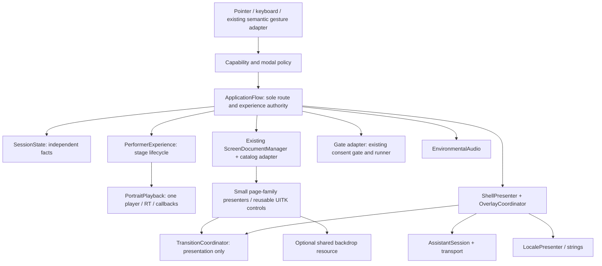

# Target runtime architecture

Stage 1 proposal · 13 November 2026 · no new runtime classes/assets created.

## Design objective and limits

Separate changing presentation from protected session, input and media contracts. Retain one application flow authority, current logical screen IDs, explicit locale mappings, one capture owner and one active performer/video session. The target is a small set of bounded collaborators, not a generic service framework or a wholesale scene rewrite. AC-02 is a coupling risk, not proof that the current controller is nonfunctional.

All names below describe proposed responsibilities. Approve the migration and impact before implementation. No DI container, tween package, localization package, second camera, replacement gesture pipeline or speculative deferred-feature backend is required.

## Proposed boundaries

| Responsibility | Current source owner → target | Contract and lifetime |
| --- | --- | --- |
| Route/history/experience decisions | App controller → `ApplicationFlow` behind same facade initially | Validate before state/history commit; serial command handling; no UI path manipulation |
| Session facts | App + Home fields → explicit session model | Locale, visitor consent decision, awakening state, selected performer and history independently represented; consent never persisted |
| Capabilities / priority | Scattered guards → one derived policy | Inputs are route/phase/modal/capture/service state; returns available/deferred/unavailable + reason; no duplicate mutable truth |
| Documents/catalog | Existing manager/catalog → retain, narrow adapter | One active main page; stable IDs and EN/ZH/GUID/root mappings; overlay visibility only, not business navigation |
| View binding | `BindCurrentScreen` + Home hard-coded groups → family presenters | Own event subscriptions, semantic controls, focus/default action; `Bind`/`Dispose` scoped to one view generation |
| Performer flow | App coroutine/state cluster → performer coordinator | Six fixed identities + five phases, selected performer invariant, explicit preparation/play/completion/cancel |
| Portrait playback | App VideoPlayer/RT functions → single playback owner | One reused player; owned RT/image/handlers; completion once per playback generation; dispose idempotently |
| Camera policy | App route rules + gate → thin gate adapter | Keep `GestureCameraConsentGate`, runner, bootstrap and source; decision vs suspension vs readiness separate |
| Gesture recognition | Existing S5/S6 → retain recognizer/bridge | Preserve thresholds, main-thread dispatch and semantic meanings; adapter gates commands by current modal/phase |
| Audio | App environmental methods → bounded audio owner | Optional approved clip; generated chime fallback; once/loop/toggle; stop/dispose scope explicit |
| Assistant | App UI + request → session/presenter + HTTPS transport | Performer context separate from active performer; exactly one request/session; cancel/late-response guards on every exit/disable |
| Locale | Home language preference + app conditionals → shared locale presentation | Keep en/zh compatibility; text content by role/key; no route/video reset merely to change shell language |
| Motion | App fades/schedules → transition scope | Visual properties only; result includes cancelled/superseded; no navigation authority |
| Glass | Tinted UXML → tokenized component + optional resource owner | One compatible shared source, bounded targets; no capture without authorized compositing plan |

Introduce interfaces only at real seams that need substitution: media events, assistant transport and a clock for isolated state tests. Plain collaborators and serialized references are sufficient elsewhere. Do not create dormant `ISouvenirService`, calibration framework or preference storage merely to reserve space. Design those contracts on paper until D1 scope is approved.

## State model and protected contracts

Maintain explicit facts rather than overload a screen string or selected performer to mean assistant theme. Proposed domains:

- Visitor session: language, consent decision, awakening phase, selected performer, return context.
- Capture: route eligibility, temporary suspension, gate granted state, runner readiness/fault, preview requested/visible; derived permission cannot exceed consent.
- Performer operation: selected ID/code, phase, playback generation, loading/playing/complete/failed/cancelled, configured missing-video policy.
- Presentation: route generation, active page, top modal, transition generation, focused semantic ID.
- Assistant: assistant theme/context, view generation, request generation, sending/failed/reply/cancelled and failed prompt for Retry.

Do not collapse the current two awakening flags until their first-entry/re-entry behavior has an approved transition table. No reset behavior changes are implied by extracting them. A future reset action (F31, C) needs an approved field-by-field reset contract.

### Route transaction

Validate capability/destination/asset before clearing the old view. Resolve presenter/document and prepare a usable tree. Commit route/session/history once. Dispose old view callbacks and media/request scopes according to an explicit leave contract. Enter new scope and start presentation. If preparation fails, keep the prior usable page and show a localized error. Reject stale callbacks by generation; repeated same-screen entry must still be distinguishable. Current `Navigate` mutates history/clears bindings before `ScreenDocumentManager.Activate` success, so this transaction boundary deserves focused migration testing.

### Media operation

Keep clip index and performer code identity stable across every locale. Prepare/first-frame/finish/error callbacks capture the playback generation; checking the reused VideoPlayer instance alone is not enough for re-entry safety. Preparation does not mean playback, playback does not mean first visible frame, and cancellation does not mean completion. Stop/cancel unregisters handlers before releasing owned resources. Preserve the last frame through a completion fade where required, release on exit, and retain the existing configurable timed/hold placeholder behavior.

Video audio remains off unless specifically approved. Keep VP8-compatible import/playback intent and validate actual Windows imported output later. Do not introduce a second player for backdrop blur.

### Requests and disable

All assistant views close through the same session disposal path, including PostVideo without an overlay. Abort/dispose request, stop coroutine and invalidate generation on navigation, overlay close, component disable/destroy and visitor reset. Replies never target a detached tree; use actual view context rather than global `selectedPerformer`. Keep credentials exclusively backend-side and make no live service calls during static validation. Conversation history/curated knowledge is a separate feature decision, not something implied by extracting transport.

### Input and privacy

One command adapter masks experience input while an overlay is active; prevent root click capture from taking shell clicks. Privacy stop is synchronous at the gate, while remaining teardown resolves to a stable view. Temporary Settings suspension does not erase the session consent choice, and reopening a panel never grants permission. Modified MediaPipe sample files stay active application integration code. Introducing first-party asmdefs later must respect that the gate/runner currently live in the sample assembly and app code references it; verify assembly direction before moving files.

## Serialized migration and impact

| Step | Likely affected files/assets | Risk and mitigation |
| --- | --- | --- |
| 1. Preserve baseline | Existing source/scene/catalog/importers; new isolated tests only when authorized | Record serialized values/GUIDs and route contracts; no broad reformat or rename |
| 2. Extract behind facade | `AwakeningApplicationController.cs`, small new C# collaborators | Keep serialized facade fields initially; pass existing dependencies, reduce one responsibility at a time |
| 3. Shell/policy | `ScreenDocumentManager.cs`, Home/app bindings, SampleScene, new approved shell UXML/USS | Overlay stacking/input/focus/capture behavior; reviewed policy and route matrix before rollout |
| 4. Semantic components | Family presenters, catalog/bindings, exported UXML/USS under explicit design scope | Keep old import identity as provenance; validate each action role and locale before removing path adapters |
| 5. Media/request ownership | Existing player/audio/preview/request functions and references | Generation/cancel tests, all-six media validation; retain one owner throughout cutover |
| 6. Rendering/motion | Panel/renderer assets only if approved; transition implementation | Separate feature flags/configuration and fallback; no simultaneous major renderer and flow rewrite |
| 7. Cleanup | Proven obsolete paths/assets only after P10 proposal | Transitive GUID/string/Resources/build review, concrete diff and separate destructive approval |

Keep existing `.meta` GUIDs and serialized field compatibility. If fields move, migrate values explicitly and compare scene YAML/reference resolution; do not rely on defaults. Do not rename the repository folder. Retain the current fallback path until its supported bootstraps are understood; remove only after a reviewed cleanup proposal. No temporary dual execution of capture, flow or video is acceptable.

## Testable contracts and rollback

Once implementation is separately authorized, isolated state/capability tests should verify rejected navigation leaves state/history untouched; locale changes don't alter consent/performer; overlay dismissal precedes page restrictions; media completion occurs exactly once; stale request/video callbacks cannot affect a new generation; privacy stop leaves capture denied. Inspect every Edit Mode test for camera/network/runtime/asset writes first.

Use small reversible commits per extraction/family. Keep previous UXML/catalog/binding/scene versions together; rollback is a coordinated version revert, not deletion of dependencies or caches. Rendering enhancement can be disabled independently, but must never create a second active input/flow authority. Acceptance requires [the pending validation matrix](TransformationAudit/ValidationAndPerformancePlan.md); no architecture diagram establishes runtime correctness.
