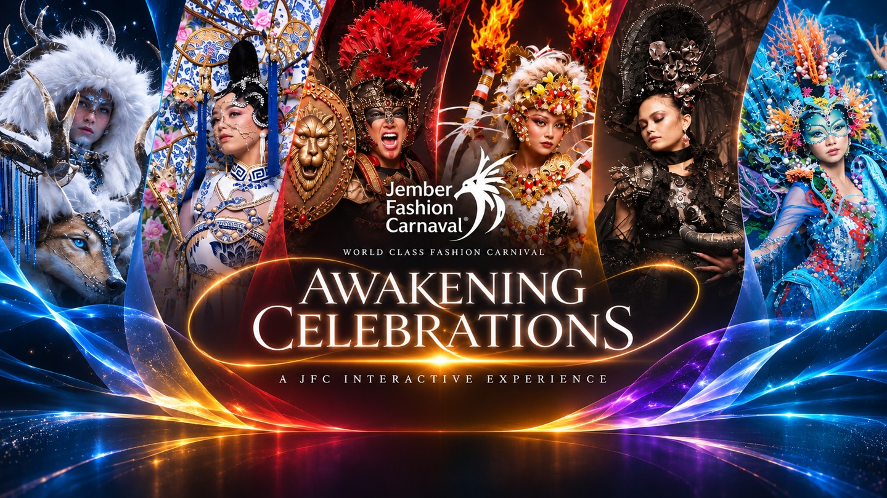
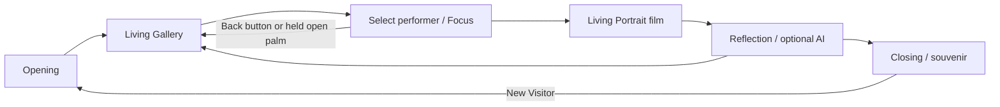
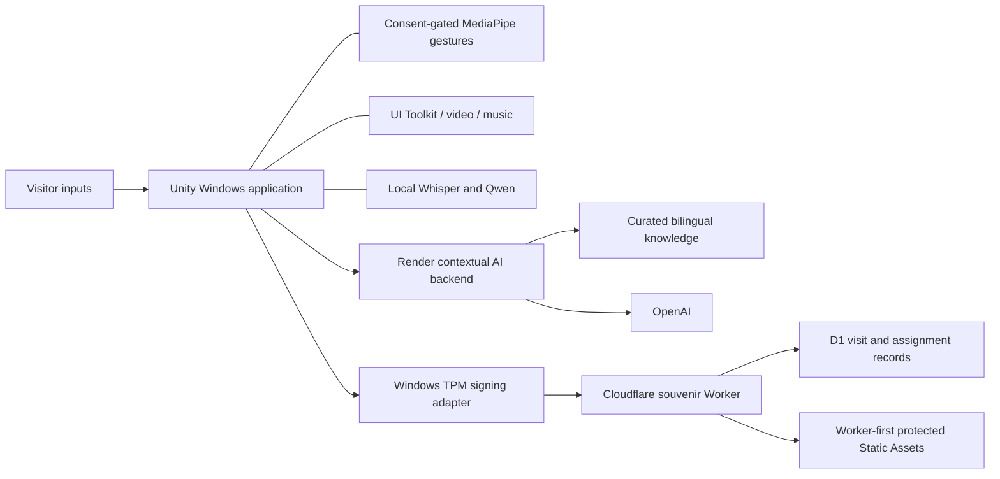

# Awakening Celebrations Ver.ka

**An Immersive Jember Fashion Carnaval Interactive Experience**




**Fashion becomes an experience. Stories come alive.**

Awakening Celebrations transforms a fashion showcase into a visitor-led encounter with six cinematic presences. Inspired by Jember Fashion Carnaval 2026 **HEAL — Humanity, Earth and Life**, the installation brings together a Living Gallery, touchless interaction, bilingual conversation, local voice tools and a digital keepsake beyond the screen.

The shipped application is named **Awakening Celebrations**. *Ver.ka* identifies this project; the repository directory does not need to be renamed.

[Experience](#the-visitor-experience) · [Architecture](#behind-the-experience) · [Development](#setup-and-development) · [Verification](#development-and-verification) · [Rights](#credits-license-and-usage)

## Six performers, six worlds

The exhibition offers six selectable performer journeys. These represent featured defile identities, rather than verified biographies of individual models. The broader festival includes other defiles; this installation does not reproduce its entire program.

| Presence | Narrative focus |
| --- | --- |
| **GAIA** | Earth as a source of life and the balance people are called to protect. |
| **PANDEMIC** | Human and social vulnerability when ordinary life is disrupted. |
| **RE-BIRTH** | Repair, cooperation and the possibility of recovery after crisis. |
| **SANCTUARY** | A place for reflection, healing and care for living beings. |
| **WHITE-GUARDIAN** | Protection of a frozen world threatened by warming and human action. |
| **CONSCIENCE** | Empathy and moral choices in the face of power and greed. |

These summaries follow the project's [curated HEAL records](awakening-ai-backend/knowledge/data/defiles.json). Festival interpretation, exhibition artwork descriptions and confirmed credits are recorded separately; costume authorship should not be inferred from appearance.

## The visitor experience

Visitors discover a presence, enter its cinematic world, reflect and choose whether to continue exploring or end their visit. Mouse, keyboard and supported touch interactions remain available alongside the camera-based gesture path.



Privacy, tutorial and Awakening precede Gallery entry. Focus leads through Activation into the film, followed by Release and Reflection. The diagram groups those transitions for readability.

### Implemented highlights

| Area | Experience |
| --- | --- |
| **Living Gallery** | Six selectable presences, consistent pointer feedback and conventional input alternatives. |
| **Natural interaction** | Consent-gated MediaPipe tracking; point to target, fist to confirm, raised hands to activate, and held open-palm Back on Focus. Gesture availability follows the current screen state. |
| **Cinematic journeys** | Six latest Full HD performer films with embedded audio, natural completion, release and reflection transitions. Original asset GUIDs are retained; problematic frame skipping is disabled. |
| **Music and Settings** | Separate opening and Gallery tracks. Gallery music continues through pre-video screens and fades before film audio begins. The bilingual Sound control affects background music only. |
| **Visitor assistance** | Contextual OpenAI-backed responses using curated exhibition knowledge, with English and Traditional Chinese interfaces. |
| **Voice** | Local Whisper dictation with transcript review; user-requested local Qwen reply playback through Listen / 朗讀. |
| **Visitor lifecycle** | Closing New Visitor and confirmed Settings Restart share the accepted reset path. Background Sound returns to ON; unresolved souvenir reset recovery is preserved. |
| **Digital keepsake** | One random souvenir assignment per qualifying visit, protected QR preview/download and fixed expiry. Availability is operator-controlled independently of the Unity build. |

Clap recognition currently invokes the established environmental-audio path, with a fallback chime when no environmental clip is assigned. **Clap-triggered Gallery music and Gallery VFX are deferred**, and should not be confused with the implemented automatic Gallery soundtrack.

## Behind the experience

The Unity client owns navigation, presentation, input and local media. Cloud AI and souvenir delivery are separate services; speech capture and reply synthesis use installed local runtime resources.



### Technology stack

| Component | Implementation |
| --- | --- |
| Application | Unity **6000.4.7f1**, C#, Windows x64; accepted release uses Mono |
| Presentation | UI Toolkit, Universal Render Pipeline, English / Traditional Chinese |
| Interaction | Unity input handling and MediaPipe Unity plugin **0.16.3** |
| Media | Unity VideoPlayer and AudioSources; resource-based media loading |
| Assistant | Node.js / Express on Render, OpenAI, curated contextual retrieval |
| Speech recognition | Local Whisper CLI with packaged models and native dependencies |
| Speech synthesis | Local Qwen runtime and operator-installed configuration |
| Souvenirs | TypeScript Cloudflare Worker, D1, protected Static Assets; ZXing QR generation in Unity |
| Kiosk security | Windows CNG, non-exportable TPM-backed ECDSA P-256 signing key |

### AI, voice and accessibility

The assistant receives supported locale and exhibition context, retrieves relevant curated records and asks the provider for a grounded reply. It is an exhibition guide, not an unrestricted source of verified facts. Missing service configuration and network failures have unavailable/error states.

Dictation records a bounded utterance and returns editable text. The visitor chooses when to submit it; speaking does not automatically send an AI question. Listen / 朗讀 requests reply audio through the existing local Qwen path. Background Sound OFF does **not** mute performer films, assistant speech or tutorial narration.

Camera capture requires session consent. Microphone availability also depends on Windows permissions, hardware and local runtime installation. Pointer, keyboard, overlay focus and bilingual navigation are part of the accepted interface; this is not a claim of formal accessibility certification.

### Digital souvenirs

After a genuine performer journey reaches the required Closing milestone, a completed visit can receive **one** assignment. Selection is uniform across active approved artworks and independent of the performer explored. Retries return the same assignment.

The Closing QR links to protected preview/download delivery. Its default lifetime is a fixed **30 minutes**, with no extension on rescan; expiry and revocation are enforced by the service. The registered kiosk authenticates using its device key, which is not shipped in the Player or repository.

**Issuance may be enabled or paused operationally.** A source checkout or a working Unity build does not grant production access. Final downloadable artworks are privately published and deliberately excluded from this public repository; the synthetic placeholder remains a local test fixture, not a normal production selection.

## Repository map

```text
Assets/
  Art/                         Approved exhibition visual resources
  LivingGlass/                 UI, flow integration, speech and souvenir clients
  Resources/                   Performer videos, music and cursor assets
  Scenes/                      Production AwakeningLivingGlass scene
  Scripts/                     Application controller and interaction systems
Packages/                      UPM manifest, lockfile and embedded tooling
ProjectSettings/               Versioned Unity / Player configuration
awakening-ai-backend/          Contextual AI service and curated knowledge
souvenir-service/              Worker source, D1 migrations and focused tests
Documentation/                 Architecture, stage reports and operating guidance
  ReadmeAssets/                Small public README image derivative
```

`Library`, `Temp`, `Logs`, `UserSettings`, local speech installations, cloud authentication data and private artwork are ignored. Standalone Windows builds are maintained outside the repository. Historical acceptance reports remain as evidence; their dated operational statements may have been superseded.

## Setup and development

### 1. Prepare the Unity project

1. Clone the repository and use `development/stage-5.2-jfc-ai` for this checkpoint. Media uses ordinary Git tracking, not Git LFS; allow sufficient disk space for the videos and Unity import cache.
2. Install Unity **6000.4.7f1** through Unity Hub, including Windows Build Support matching the accepted Mono Windows x64 target. Open this repository root as the project.
3. **Resolve the local MediaPipe package dependency before expecting a clean import.** The committed manifest currently points to a developer-local `com.github.homuler.mediapipe-0.16.3.tgz`. Obtain the compatible package and native dependencies through their permitted distribution, then resolve that local package reference on your machine. The checkout alone does not supply that archive.
4. Let Unity resolve the remaining packages. The repository includes the local Unity MCP tooling; its presence is not a prerequisite for visitors to run a packaged exhibition.
5. Open `Assets/Scenes/AwakeningLivingGlass.unity`, the enabled production scene in Build Settings. Preserve serialized scene, asset and `.meta` references.

On an operator-authorized development machine, enter Play Mode to use the exhibition. Camera capture remains subject to the in-app consent flow; do not bypass it for tests. Automated agents must also follow [AGENTS.md](AGENTS.md), including explicit authorization before Play Mode or capture-related testing.

### 2. Configure optional services and speech

- **AI:** see the [backend setup](awakening-ai-backend/README.md) and [contextual API contract](Documentation/Stage5AIKnowledge/Stage5_2/Stage5_2_APIContract.md). Node.js 20+ is documented for this service. Configure server credentials privately; never embed an OpenAI key in Unity. Point the client at an authorized compatible backend using its existing configuration.
- **Whisper:** follow the [local speech deployment notes](Documentation/Stage4VoiceExperience/Stage4_2/Deployment.md). `VoiceLocal` requires the CLI, models, native libraries and Traditional Chinese conversion resources. It is not committed. The accepted installation checks CUDA-related dependencies; do not assume generic Windows hardware can run it without that setup.
- **Qwen:** follow the [runtime plan](Documentation/Stage4VoiceExperience/Stage4_3/Stage4_3B_RuntimePlan.md) and its non-secret configuration example. The private `QwenLocal/config.json` and `QwenLocal/RuntimePack/` installation must be provided by a trusted operator. Runtime and model/voice rights must be respected.
- **Souvenirs:** see the [architecture](Documentation/Stage5Souvenir/Stage5_3A_Architecture.md) and [Unity integration acceptance](Documentation/Stage5Souvenir/Stage5_3B6_B8_IntegrationAcceptance.md). Development requires separate local configuration; production needs authorized registration and a device key. Do not copy another kiosk's enrollment or credentials.

The souvenir service declares Node.js **22.12+** and pnpm **11.25.0** in its package manifest. Use its existing local-development and test scripts; local test authentication must never become a production bypass. Do not deploy services or change issuance as an incidental setup step.

### 3. Produce a Windows package

Use the production scene and established Player settings: **Awakening Celebrations**, Windows x64, Mono, Fullscreen Window and the approved icon/splash. Alt+Enter provides windowed troubleshooting. Build outside the repository.

A Unity build alone does not provision the speech sidecars. Package the approved `VoiceLocal` and `QwenLocal` directories beside the executable, preserving the required configuration, runtime libraries and models. Do not include keys, enrollment files or cloud secrets. Verify packaging against the [Stage 5.7 build record](Documentation/Stage5Media/Stage5_7_FinalIntegrationAcceptance.md) before runtime acceptance. The existing enrolled laptop's credential and local visitor journal must remain in their established locations.

## Development and verification

| Checkpoint | Recorded evidence |
| --- | --- |
| [Stage 5.6 opening](Documentation/Stage5Media/Stage5_6_OpeningAcceptance.md) | Supported custom splash, fullscreen cover correction, opening soundtrack and prior listening acceptance. |
| [Stage 5.6.2 media](Documentation/Stage5Media/Stage5_6_2_PerformerVideoReplacement.md) | Six in-place media replacements, hashes, embedded audio and focused playback investigation. |
| [Stage 5.6.3 music](Documentation/Stage5Media/Stage5_6_3_GalleryMusicAndSound.md) | Gallery continuity, bilingual background Sound control, reset behavior and user listening confirmation. |
| [Stage 5.7 integration](Documentation/Stage5Media/Stage5_7_FinalIntegrationAcceptance.md) | Shared Focus Back cancellation, successful Windows package and user-confirmed launch/runtime acceptance. |
| [Stage 5.8 repository review](Documentation/Stage5Repository/Stage5_8_RepositoryFinalization.md) | Conservative retention, README verification and documentation-only Git scope. |

Evidence is scoped: source inspection, compilation, focused Editor checks, packaging checks and user-confirmed runtime results are different kinds of validation. The user verified the Stage 5.7 Back/open-palm correction and confirmed that the Windows application launches and runs correctly. This does not establish a recorded hardware test for every performer, audio transition or device. There is no claim of comprehensive automated coverage or performance certification.

## Requirements and known limitations

- **Target hardware:** Windows x64 is the accepted exhibition platform. Other operating systems and arbitrary hardware configurations are not validated release targets.
- **External dependencies:** cloud conversation needs network access and an authorized backend. Local speech needs its separately provisioned runtimes and compatible hardware. Camera and microphone permission/device failures remain possible.
- **Reproducibility:** the local-path MediaPipe archive, private speech resources, protected final souvenir artwork and kiosk registration are not supplied by a public clone. Build tooling and reports must be read in their dated context.
- **Media storage:** six large MP4s are already tracked in ordinary Git. No LFS migration or media recompression is implied; do not rewrite history or downgrade media to reduce checkout size.
- **Deferred work:** clap-triggered Gallery soundtrack effects, subtle Gallery VFX and a consolidated exhibition rehearsal remain separate milestones. Issuance activation is an operator decision, not a README default.

## Credits, license and usage

Acknowledgment goes to **Jember Fashion Carnaval** for the cultural and creative context of HEAL, and to the creators of the featured fashion, branding and media. The repository's [source records](awakening-ai-backend/knowledge/data/sources.json) distinguish research sources and verified attribution; this project does not assert an official partnership or endorsement.

Development history is available through the [repository contributors](https://github.com/Kiraakatsuki/Awakening_Celebrations_Ver.Ka/graphs/contributors). Technology acknowledgments include Unity, MediaPipe, OpenAI, Whisper, Qwen, Render, Cloudflare and ZXing.Net. Third-party notices, including the [ZXing Apache 2.0 license](Assets/LivingGlass/Souvenirs/ThirdParty/Apache-2.0.txt), apply to their respective components.

**No repository-wide LICENSE file is currently provided.** Public source availability does not establish an MIT, Apache, GPL or other blanket reuse license. JFC branding, performer imagery and videos, supplied music, voice resources and restricted souvenir artwork have separate rights and distribution requirements. Permission to use or redistribute them should not be inferred from their presence in a public project. The README banner is a resized derivative of the already-versioned approved startup artwork; it conveys no additional reuse rights.

---

**Where fashion, cultural storytelling and technology become an encounter.**
